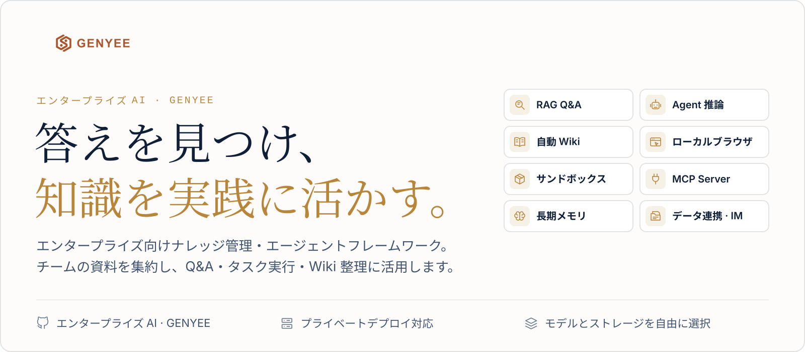
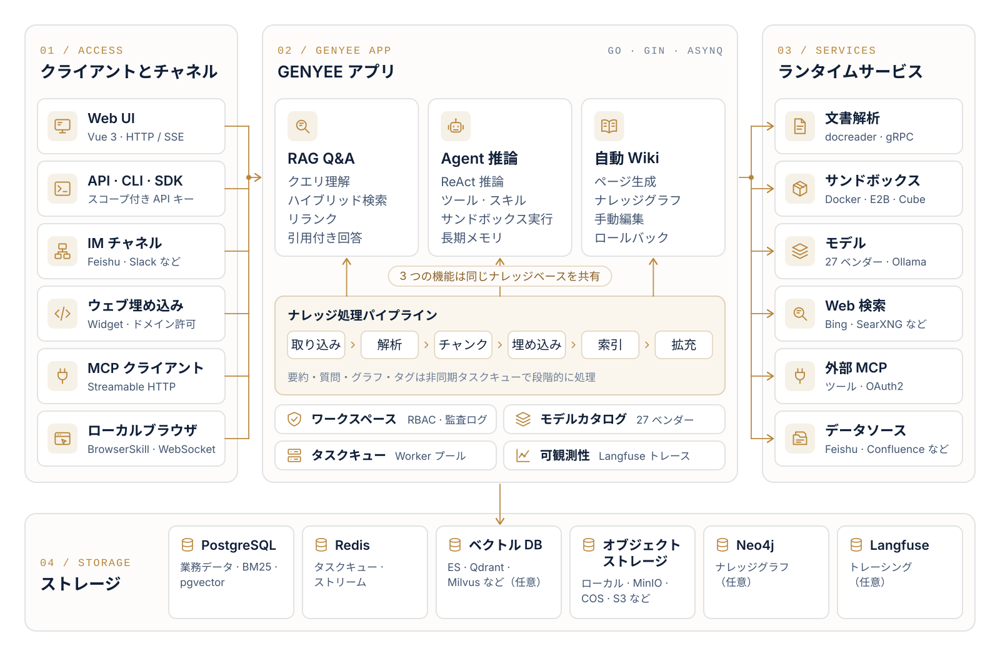

<p align="center">
  <a href="./website-docs/01-getting-started/01-introduction.md">
    <picture>
      <source media="(prefers-color-scheme: dark)" srcset="./docs/images/readme/hero-ja-dark.svg">
      
    </picture>
  </a>
</p>

<p align="center">
  <a href="./website-docs/01-getting-started/01-introduction.md"></a>
  <a href="./CHANGELOG.md"></a>
  <a href="./LICENSE"></a>
</p>

<p align="center">
  <a href="./README.md">English</a> · <a href="./README_CN.md">简体中文</a> · <b>日本語</b> · <a href="./README_KO.md">한국어</a>
</p>

<p align="center">
  <a href="#プロジェクト紹介">プロジェクト紹介</a> ·
  <a href="#クイックスタート">クイックスタート</a> ·
  <a href="#最新アップデート">最新アップデート</a> ·
  <a href="#機能概要">機能概要</a> ·
  <a href="#クライアントとエコシステム">クライアント</a> ·
  <a href="#ドキュメント">ドキュメント</a> ·
  <a href="#開発ガイド">開発ガイド</a>
</p>

## プロジェクト紹介

**[GENYEE](./website-docs/01-getting-started/01-introduction.md)** は、大規模言語モデル（LLM）をベースとしたエンタープライズ向けナレッジフレームワークで、文書理解、セマンティック検索、推論に対応します。チームに散在する文書を集約し、検索・推論に使えるようにし、資料の更新に合わせて維持します。


<p align="center"><sub>v0.9.0 · 2 分 45 秒 · 1080p60 · 英語ナレーション・字幕付き</sub></p>

資料の検索には RAG、マルチステップのタスクには Agent、ナレッジの整理には Wiki。3 つの機能は同じナレッジベースを共有します。

<picture>
  <source media="(prefers-color-scheme: dark)" srcset="./docs/images/readme/capabilities-ja-dark.svg">
  
</picture>

**Agent のツールボックス。** ClawHub / SkillHub / Git / ZIP からインストールしたスキルは、セッション単位で永続する Docker / E2B / Cube サンドボックスで動作し、チャットの横でインタラクティブターミナルとグラフィカルデスクトップを開けます。BrowserSkill 拡張機能を通じて Agent はユーザー自身の Chrome / Edge を操作でき、外部 MCP サービス（OAuth 対応）を接続してツールごとに有効化できます。

そのほか：

- **メモリとナレッジ整理**：クロスセッション長期メモリが、ユーザーが確認したプロフィール・好み・事実を保持します。フォルダーアップロードは元のディレクトリ構造を保ち、検索チャンクは編集・差分比較・ロールバックできます。
- **データソースとフォーマット**：Feishu ナレッジベース / Feishu クラウドドライブ / Confluence / GitLab / Tencent IMA / Notion / Yuque / DingTalk Docs / Seafile / RSS の自動同期（順次拡充中）。PDF、Word、画像、Excel、XMind など 10 以上のフォーマットに対応し、Office 文書は anydoc でプロセス内解析します。
- **チャネルと連携**：WeChat Work、Feishu、Slack、Telegram などの IM で直接 Q&A、ウェブサイト埋め込み Widget で外部サイトにエージェントを公開、組み込み MCP Server で Cursor や Claude などの AI ツールと接続、スコープ付き API キーと Principal モデルでプログラム連携。
- **モデル**：29 の組み込みベンダーと自動生成のモデルカタログ。OpenAI、DeepSeek、Qwen（Alibaba Cloud）、Zhipu、Hunyuan、Gemini、MiniMax、NVIDIA、LiteLLM、Ollama などに対応。
- **権限と運用**：マルチワークスペース RBAC（4 階層ロール、リソース所有権、ワークスペース監査ログ）、ワークスペースごとの複数ストレージインスタンス、ランタイムタスクキューダッシュボードと Worker プール統治、Langfuse による Agent ステップ・トークン消費・パイプラインのトレーシング。
- **デプロイ**：LLM、ベクトルデータベース、ストレージバックエンドはすべて差し替え可能。ローカルまたはプライベートクラウドにデプロイし、データを自社環境に置けます。

## クイックスタート

Docker Compose または Kubernetes を使用して自分の環境に GENYEE をデプロイし、モデル・ストレージ・ネットワークを自分で設定します。

### Docker Compose でデプロイ

[Docker](https://www.docker.com/)、[Docker Compose](https://docs.docker.com/compose/)、[Git](https://git-scm.com/) が必要です。

```bash
git clone <repository-url>
cd GENYEE
cp .env.example .env    # 必要に応じて .env を編集（詳細はファイル内のコメント参照）
docker compose pull     # 最新イメージを取得
docker compose up -d    # コアサービスを起動
```

起動後、**[http://localhost](http://localhost)** にアクセスし、オンボーディングガイドに沿って設定してください。サンプルデータ付きの手順は[クイックスタート](./website-docs/01-getting-started/03-quickstart.md)（中国語）を参照してください。

> [!TIP]
> ローカル Ollama モデルを使用する場合は、先に `ollama serve > /dev/null 2>&1 &` を実行してください。Ollama の埋め込みモデル名、`OLLAMA_BASE_URL`、メモリの注意は[設定ドキュメント](./website-docs/01-getting-started/04-configuration.md)を参照してください。

| サービス | URL |
|---------|-----|
| Web UI | `http://localhost` |
| バックエンド API | `http://localhost:8080` |
| Langfuse トレーシング | `http://localhost:3000` |

### オプションサービス

`--profile` フラグで追加コンポーネントを有効化します。複数の profile を組み合わせ可能です。

| Profile | 説明 |
|---------|------|
| _(デフォルト)_ | コアサービス |
| `full` | 全機能 |
| `neo4j` | ナレッジグラフ (Neo4j) |
| `minio` | オブジェクトストレージ (MinIO) |
| `langfuse` | トレーシング (Langfuse) |

```bash
docker compose --profile neo4j --profile minio pull
docker compose --profile neo4j --profile minio up -d
docker compose down     # サービスを停止
```

### アップグレード

既存のデプロイがあり、新しい release をダウンロードした場合：

```bash
# .env の GENYEE_VERSION を対象バージョン（例: 0.9.0）に設定、または latest のまま
docker compose pull     # GENYEE_VERSION に一致するイメージを取得
docker compose up -d    # 新しいイメージでコンテナを再作成
```

> [!NOTE]
> `docker compose up -d` のみではローカルキャッシュのイメージが再利用され、Web UI の表示バージョンがダウンロードした release と一致しない場合があります。アップグレードする前に[アップグレードの注意事項](./website-docs/07-releases/v0.9.0.md#upgrade-notes)を確認してください。

### その他のデプロイ方法

| 方法 | 用途 |
|------|------|
| **Docker Compose** | 上記の標準デプロイ。全機能、複数サービス構成 |
| **Kubernetes (Helm)** | 本番クラスター。Chart は [`helm/`](./helm) にあります |
| **Lite シングルバイナリ** | ローカルや低リソース環境向け、外部依存なし（SQLite + インメモリキュー）。標準版との違いは [Lite と標準版の違い](./docs/LITE.md)（中国語） |
| **デスクトップアプリ** | GUI 付きの Lite ランタイム。ログイン不要で起動し、macOS ではホストサンドボックスを提供。インストーラーは未公開のため、ソースからビルドしてください |

すべてのデプロイ形態、ハードウェア要件、構成例は[インストールガイド](./website-docs/01-getting-started/02-installation.md)を参照してください。

> [!WARNING]
> GENYEE にはログイン認証がありますが、本番環境でのデプロイでは以下を強く推奨します：
> - GENYEE サービスはパブリックインターネットではなく、内部 / プライベートネットワーク環境にデプロイする
> - 情報漏洩を防ぐため、サービスを直接パブリックネットワークに公開しない
> - デプロイ環境に適切なファイアウォールルールとアクセス制御を設定する
> - セキュリティパッチと改善のため、定期的に最新バージョンに更新する

## 最新アップデート

### v0.9.0 <sub>· 2026-10-29 · [リリースノート](./website-docs/07-releases/v0.9.0.md)</sub>

- **[GENYEE アシスタント](./website-docs/07-releases/v0.9.0.md#assistant)**: GENYEE のバージョン更新、機能や設定について回答。表示中のページをもとに、現在のユーザーの権限でエージェント作成、タスクの定期実行、ナレッジ整理や設定変更を支援。
- **[マルチエージェント連携](./website-docs/07-releases/v0.9.0.md#collaboration)**: タスクを分担し、進捗を確認して結果をまとめます。
- **[自動化](./website-docs/07-releases/v0.9.0.md#automations)**: 一回限り・定期実行の計画、実行履歴、結果と承認通知。
- **[実行権限と承認](./website-docs/07-releases/v0.9.0.md#permissions)**: 読み取り専用、変更前に確認、自動実行の三段階と範囲を限定した許可。
- **[サンドボックスとバックグラウンド処理](./website-docs/07-releases/v0.9.0.md#sandbox)**: ユーザー単位の再利用、バックグラウンド Shell、スキル更新方式。
- **[解析・同期・検索](./website-docs/07-releases/v0.9.0.md#knowledge)**: 画像処理パイプライン、OCR 前処理、Feishu/Lark 同期、Confluence PAT と検索の改善。
- **[アップグレード案内](./website-docs/07-releases/v0.9.0.md#upgrade-notes)**: DB 移行、Feishu 再同期、サンドボックス再利用スイッチと設定変更を確認してください。

### v0.8.3 <sub>· 2026-10-14 · [リリースノート](./website-docs/07-releases/v0.8.3.md)</sub>

- **[画像ギャラリー](./website-docs/07-releases/v0.8.3.md#images)**：文書内の画像を一覧表示し、出典・説明・OCR・画像属性で絞り込み。
- **[マルチモーダル Embedding](./website-docs/07-releases/v0.8.3.md#multimodal-embedding)**：テキストと画像を同じベクトル空間で扱うモデルに対応。Tencent WeMM-Embedding や Qwen3-VL-Embedding などを利用でき、画像ベクトル検索と対応モデルによる画像リランキングを任意で有効化。
- **[Wiki グラフ](./website-docs/07-releases/v0.8.3.md#wiki-graph)**：グループ配置とテーマ説明を改善。グループへのフォーカス、切り替え、全体表示への復帰に対応。
- **[原文引用](./website-docs/07-releases/v0.8.3.md#conversation)**：回答から原文の引用箇所へ直接移動。
- **[会話とツール](./website-docs/07-releases/v0.8.3.md#tools)**：サンドボックス不要の添付ファイルのオンデマンド読み取り、未読返信、@ 検索、Docker ターミナル、Lite ローカルスキル、MCP 互換性の改善。
- **[管理と連携](./website-docs/07-releases/v0.8.3.md#administration)**：ユーザー管理、招待による登録、管理者モデルカタログ、WeMM、TEI/Pinecone/Cohere、Seafile、繁体字中国語。
- **[安定性](./website-docs/07-releases/v0.8.3.md#other-changes)**：検索、解析、同期、Wiki、OAuth を修正。登録モード、空のツール一覧、DB 移行と再インデックスについては[アップグレード案内](./website-docs/07-releases/v0.8.3.md#upgrade-notes)を確認してください。

### v0.8.2 <sub>· 2026-09-24 · [リリースノート](./website-docs/07-releases/v0.8.2.md)</sub>

エージェントがあなたのコンピューターのブラウザを操作できるようになり、ナレッジベースを MCP で他の AI ツールに公開でき、実行中の会話に要件を追加したり分岐・巻き戻ししたりできます。

- **[ローカルブラウザ（BrowserSkill）](./website-docs/07-releases/v0.8.2.md#local-browser)**：オープンソースの BrowserSkill 拡張機能を通じて、エージェントがユーザー自身の Chrome / Edge を操作します。ライブのタスクプレビュー、一時停止 / 再開に対応し、ログインや CAPTCHA はユーザーに引き継ぎます。
- **[組み込み MCP Server](./website-docs/07-releases/v0.8.2.md#mcp-server)**：ワークスペース単位の `/mcp/<endpoint_id>` エンドポイント（Streamable HTTP）。エンドポイントごとにトークン・ナレッジベース範囲・レート制限・ツールグループを設定します。Python 版 `mcp-server/` は非推奨です。
- **[会話コントロール](./website-docs/07-releases/v0.8.2.md#conversation-control)**：実行中のターンへの要件追加、過去の任意の質問からの分岐、サンドボックスのチェックポイントと連動したその場での巻き戻し、セッション単位の推論強度。生成ファイルは新しい成果物ライブラリにまとまります。
- **[サンドボックス](./website-docs/07-releases/v0.8.2.md#sandbox)**：インタラクティブターミナルとグラフィカルデスクトップ、macOS の Lite ホストサンドボックスとプロジェクトフォルダー、スキル・MCP サービス・ブラウザ接続をまとめたサイドバーのツールボックス。
- **[モデル](./website-docs/07-releases/v0.8.2.md#models)**：再構築されたモデルカタログ（27 の組み込みベンダー、コンテキストウィンドウ・最大出力・推論レベル・ビジョン対応を自動補完）。Agent の検索ツールを `search_knowledge` / `read_document` / `list_documents` に統合。
- **[ナレッジとプラットフォーム](./website-docs/07-releases/v0.8.2.md#knowledge)**：Confluence と DingTalk Docs データソース、Bocha と Serply の Web 検索、日本語 UI、IM チャネル単位の返信言語、ホワイトリスト限定の外部通信モード。

> [!IMPORTANT]
> **互換性のない変更：** DingTalk チャネルは Stream モードのみ、サンドボックスのコマンドは既定で `root` で実行されます。[アップグレードの注意事項](./website-docs/07-releases/v0.8.2.md#upgrade-notes)を参照してください。

### v0.8.0 <sub>· [リリースノート](./website-docs/07-releases/v0.8.0.md)</sub>

- **スキルサンドボックス実行環境**：セッション永続の Docker / E2B / Cube バックエンド、テナント単位のネットワークポリシー。Local ホストプロセスバックエンドを削除し、Docker はオプトイン。
- **テナントスキルカタログ**：ClawHub / SkillHub / git / zip からインストール、サンドボックス単位のスナップショット、ライブ進捗、ファイル閲覧 / 編集、個人・ワークスペース環境変数。
- **クロスセッション長期メモリ**：profile / preference / fact / task / interest、確認付き自動抽出、`search_memory`。
- **解析とデータソース**：プロセス内 anydoc Office パーサー、GitLab と Tencent IMA データソース、XMind 解析。
- **エコシステム**：DeepSeek Harness プラグイン（`./packages/dsh-genyee`）、LiteLLM、Exa と Metaso の Web 検索。
- **チャット**：チャット成果物、質問アウトライン、タイムスタンプ、コンテキスト圧縮とプロバイダー Prompt Cache マーカー。
- **セキュリティ**：OIDC JWKS 検証、任意の複雑パスワード、ドキュメント自動タグ付け、広範なサンドボックス / セキュリティ強化。

<details>
<summary><b>以前のバージョン（v0.2.0 – v0.7.2）</b></summary>

<br/>

- **v0.7.2** — 製品ドキュメントサイト、ナレッジベースのフォルダーツリー、チャンク編集とバージョン履歴、Wiki ページのバージョン履歴、直接読み込めるファイル URL（`resource_urls=public`）、Feishu クラウドドライブのデータソース、一括タグ付け、MCP Server 1.1（29 ツール）、AWS S3 のデフォルト資格情報チェーン。
- **v0.7.1** — Yunzhijia IM、Volcengine リランク、Zhipu AI Web 検索、プラットフォームスコープの API キー、KB 単位のアクティビティ監査、FAQ のフィルター・タグ付け・エクスポート、Langfuse OTLP トレーシング、ワンクリック Markdown エクスポート。
- **v0.7.0** — スコープ付き API キーと Principal モデル、タスクキューダッシュボードと Worker プール統治、ワークスペースごとの複数ストレージインスタンス、会話の一時添付、`@Skill / @MCP` メンション、会話中の MCP OAuth、QQBot と Lark IM、Redis TLS、`genyee` CLI v0.10。
- **v0.6.3** — ウェブサイト埋め込み Widget と統合センター（セキュアモード Token 交換 + レート制限）；チャット体験の全面刷新（引用ポップオーバー、RAG パイプライン進捗、ストリーミング Markdown）；ドキュメント複数タグと一括 reparse；Wiki フォルダーと階層ナビゲーション；RSS データソース；MCP OAuth2；EPUB / MHTML 解析；Agent モデル準備状態チェック；モデルデバッガー；セッションソースフィルター；ワークスペース削除 UI。
- **v0.6.2** — アップロード単位の解析設定（`process_config`）+ アップロード確認ダイアログ；reparse 時の設定上書き；`genyee` CLI v0.9（同梱 Agent Skills、`session stop`、auth/profile 統合）；KB マーキー複数選択；pgvector 1024 次元 HNSW インデックス；チャットリソース Store 刷新；Langfuse のみのトレーシング（Jaeger 削除）。
- **v0.6.1** — ドキュメント解析トレースタイムライン（Langfuse 風の Span ツリー、ステージごとの進捗表示 + 解析中止）；OpenSearch ベクター DB ドライバー；YAML 宣言型ビルトインモデル設定；システム管理者と統合プラットフォーム設定 + 監査ログ；新規ユーザーオンボーディングガイド；設定 UI 刷新；`genyee` CLI v0.7 / v0.8（Agent ファースト ワイヤープロトコル、NDJSON、`--dry-run`）；OpenDataLoader と PaddleOCR-VL 解析エンジン；MCP サーバーのマルチトランスポート（stdio / SSE / HTTP）；モデル単位の思考モード設定；Tencent LKEAP リランク + ネイティブ Gemini Embedding + MiniMax-M3。
- **v0.6.0** — テナント RBAC（4 階層ロールマトリクス `Owner` / `Admin` / `Contributor` / `Viewer` + KB 単位の所有 + テナントごとの監査ログ）、テナントメンバー管理とマルチワークスペース UX、セルフサービスでのワークスペース作成；`genyee` CLI v0.4 GA + `mcp serve`；KB 検索の複数ベクター DB ファンアウト；MCP / データソース資格情報の AES-256-GCM 暗号化 + docreader gRPC TLS + Token；Zhipu Embedder と華為雲 OBS の追加；サーバーサイドユーザー設定；Go 1.26.0。詳細は[テナントと認証](./website-docs/03-features/01-tenant-auth.md)（中国語）を参照。
- **v0.5.2** — Wiki インジェストが万件規模 KB に対応（タスクキュー + DLQ）；MCP 工具人機審批；Anthropic / Apache Doris / Tencent VectorDB / 金山雲 KS3 / SearXNG バックエンド；適応型 3 段階チャンキング + ライブプレビュー；グローバル ⌘K コマンドパレット；Yuque コネクタ + WeChat ミニプログラム；`genyee` CLI プレビュー版。
- **v0.5.1** — KB 一括管理；テナント全体の IM チャネル概観；セッション検索 + ユーザー単位ピン留め；モデル / Web 検索 / MCP 統一カード設定；Agent ごとの LLM タイムアウト；デスクトップ版テナント切替。
- **v0.5.0** — Wiki モード GA — Agent が原文書から構造化・相互リンクされた Markdown Wiki ページとナレッジグラフを自動生成、Wiki ブラウザと可視化グラフを UI に搭載。
- **v0.4.0** — GENYEE Cloud（ホスティング LLM + 解析）；Chrome 拡張機能；ClawHub Skill；WeChat IM；添付ファイル処理；Azure OpenAI / Alibaba OSS；Notion コネクタ；Baidu + Ollama Web 検索；VectorStore 管理。
- **v0.3.6** — ASR（音声）；Feishu データソース自動同期；OIDC；IM 引用返信 + スレッドベースセッション；ドキュメント自動要約；Tavily 検索；並列ツール呼び出し；Agent @メンション範囲制限。
- **v0.3.5** — Telegram / DingTalk / Mattermost IM；IM スラッシュコマンド + QA キュー；推奨質問；VLM による MCP ツール画像自動説明；Novita AI；チャネルトラッキング。
- **v0.3.4** — 企業 WeChat / Feishu / Slack IM；マルチモーダル画像；NVIDIA モデル API；Weaviate；AWS S3；AES-256-GCM API キー暗号化；組み込み MCP サービス；ハイブリッド検索最適化；`final_answer` ツール。
- **v0.3.3** — 親子チャンキング；KB ピン留め；フォールバック応答；Rerank パッセージクリーニング；ストレージバケット自動作成；Milvus。
- **v0.3.2** — ナレッジ検索エントリ；ソース別パーサー / ストレージエンジン設定；ローカルストレージ画像レンダリング；ドキュメントプレビュー；Volcengine TOS；Mermaid レンダリング；対話バッチ管理；メモリグラフプレビュー。
- **v0.3.0** — 共有スペース；Agent Skills + サンドボックス実行；カスタム Agent；データ分析 Agent；思考モード；Bing / Google 検索；API Key 認証；Helm Chart；韓国語 i18n；Qdrant。
- **v0.2.0** — Agent モード（ReACT）；複数タイプのナレッジベース（FAQ + ドキュメント）；対話戦略設定；DuckDuckGo Web 検索；MCP ツール統合；新 UI + Agent モード切替；MQ 非同期タスク管理。

完全な変更履歴は [`CHANGELOG.md`](./CHANGELOG.md) を参照してください。

</details>

## 機能デモ

### クイック Q&A とスマート推論

**2 つの質問方法。** クイック Q&A はナレッジベースを RAG で検索して回答し、参照した出典を示します。スマート推論ではエージェントがマルチステップの作業を計画し、検索、文書の読み込み、ツールやスキルの呼び出しを行い、各ステップを会話内に表示します。 [ドキュメント →](./website-docs/03-features/18-chat-experience.md)

<a href="./docs/images/readme/spotlight-qa-light.webp">
<picture>
  <source media="(prefers-color-scheme: dark)" srcset="./docs/images/readme/spotlight-qa-dark.webp">
  
</picture>
</a>

### ローカルブラウザ

**コンピューターのブラウザを操作。** オープンソースの BrowserSkill 拡張機能を通じて、エージェントがあなたの Chrome や Edge でページを開き、フォームに入力します。ログインや CAPTCHA ではあなたに引き継ぎます。 [ドキュメント →](./website-docs/05-clients/09-local-browser.md)

<a href="./docs/images/readme/spotlight-browser-light.webp">
<picture>
  <source media="(prefers-color-scheme: dark)" srcset="./docs/images/readme/spotlight-browser-dark.webp">
  
</picture>
</a>

### スキルとサンドボックス

**スキルを実行し、ファイルを生成。** Docker、E2B、Cube に対応。同じセッションの複数ターンは 1 つのワークスペースを共有し、生成ファイルはプレビューとダウンロードができます。会話の横でグラフィカルデスクトップやインタラクティブターミナルを開き、エージェントの各ステップを確認し、必要に応じて操作を引き継げます。 [ドキュメント →](./website-docs/03-features/22-skills-sandbox.md)

<a href="./docs/images/readme/spotlight-sandbox-light.webp">
<picture>
  <source media="(prefers-color-scheme: dark)" srcset="./docs/images/readme/spotlight-sandbox-dark.webp">
  
</picture>
</a>

### ツールボックス：MCP サービスとスキル

**エージェントが使えるツール。** 外部の MCP サービスを接続し、有効にするツールと承認が必要な呼び出しをツールごとに選べます。スキルは ClawHub、SkillHub、Git、ZIP からインストールしてワークスペースで管理し、各サンドボックスで再利用できます。 [ドキュメント →](./website-docs/03-features/22-skills-sandbox.md)

<a href="./docs/images/readme/spotlight-toolbox-light.webp">
<picture>
  <source media="(prefers-color-scheme: dark)" srcset="./docs/images/readme/spotlight-toolbox-dark.webp">
  
</picture>
</a>

### 自動 Wiki

**ドキュメントを閲覧できる Wiki に。** Wiki を有効にすると、ナレッジベースの文書から人物・製品・概念を抽出し、出典付きのページを生成してディレクトリ別に閲覧できます。ナレッジグラフでページ間の関係を確認でき、ページは直接編集でき、変更はさかのぼれます。 [ドキュメント →](./website-docs/03-features/14-wiki.md)

<a href="./docs/images/readme/spotlight-wiki-light.webp">
<picture>
  <source media="(prefers-color-scheme: dark)" srcset="./docs/images/readme/spotlight-wiki-dark.webp">
  
</picture>
</a>

### 可観測性

**トレーシングとランタイム監視。** Langfuse がエージェントの各ステップの推論、ツール呼び出し、トークン使用量を追跡します。文書解析タイムラインはステージごとの進捗を表示し、タスクキューダッシュボードは待機中と失敗したタスクを一覧します。 [ドキュメント →](./website-docs/03-features/16-observability.md)

<a href="./docs/images/readme/spotlight-observability-light.webp">
<picture>
  <source media="(prefers-color-scheme: dark)" srcset="./docs/images/readme/spotlight-observability-dark.webp">
  
</picture>
</a>

## アーキテクチャ設計

<a href="./docs/images/readme/architecture-ja-light.svg">
<picture>
  <source media="(prefers-color-scheme: dark)" srcset="./docs/images/readme/architecture-ja-dark.svg">
  
</picture>
</a>

文書解析・ベクトル化・検索から大規模モデル推論まで、各工程をモジュール化し、コンポーネントは差し替え・拡張できます。ローカルとプライベートクラウドへのデプロイに対応し、Web UI はすぐに使い始められます。詳しくは：[アーキテクチャ概要](./website-docs/02-architecture/01-overview.md) · [RAG パイプライン](./website-docs/02-architecture/04-rag-pipeline.md) · [拡張ポイント](./website-docs/06-development/03-extension-points.md)（中国語）。

## 機能概要

| 領域 | 主な機能 |
|------|----------|
| [Q&A と Agent](./website-docs/03-features/07-agent.md) | クイック Q&A はナレッジベースから出典付きで回答し、スマート推論では ReAct エージェントがナレッジベース、Web 検索、MCP ツール、スキル、ローカルブラウザを組み合わせます。実行中の会話への要件追加・分岐・巻き戻しと、セッションをまたぐ[長期メモリ](./website-docs/03-features/23-memory.md)に対応 |
| [Wiki](./website-docs/03-features/14-wiki.md) | エージェントが相互リンクされた Wiki ページとナレッジグラフを生成。ブラウザ内編集、バージョン差分とロールバック |
| [スキルとサンドボックス](./website-docs/03-features/22-skills-sandbox.md) | ClawHub / SkillHub / Git / ZIP からインストールするスキルカタログ。セッション単位で永続する Docker / E2B / Cube サンドボックスと設定単位のネットワークポリシー。チャットの横にインタラクティブターミナルとグラフィカルデスクトップ |
| [ナレッジベース](./website-docs/03-features/02-knowledge-base.md) | FAQ・ドキュメント・Wiki の 3 種類。フォルダーツリー、チャンク編集とバージョン履歴、アップロード単位の解析・チャンキング・マルチモーダル設定、自動タグ付け |
| [検索](./website-docs/03-features/05-retrieval-engines.md) | キーワード + ベクトルのハイブリッド検索、リランク、親子チャンキング、GraphRAG（[Neo4j](./website-docs/03-features/09-knowledge-graph.md)）。リコール的中率と BLEU / ROUGE によるエンドツーエンド評価 |
| [権限とセキュリティ](./website-docs/03-features/01-tenant-auth.md) | 4 階層ロールと監査ログを備えたワークスペース RBAC、スコープ付き API キー、OIDC、AES-256-GCM による資格情報の暗号化、SSRF 対策済みの外部通信とホワイトリスト限定モード |
| [運用](./website-docs/03-features/16-observability.md) | Langfuse による Agent ステップ・トークン消費・パイプラインのトレーシング、ドキュメント解析タイムライン、Worker プール付きのタスクキューダッシュボード、バージョンアップ時の自動 DB マイグレーション |

### 対応バックエンド

| コンポーネント | 選択肢 |
|----------------|--------|
| [大規模モデル](./website-docs/03-features/06-models.md) | 29 の組み込みベンダー。OpenAI / Azure OpenAI / Anthropic / DeepSeek / Qwen（Alibaba Cloud）/ Zhipu / Hunyuan / Doubao（Volcengine）/ Gemini / MiniMax / NVIDIA / SiliconFlow / OpenRouter / LiteLLM / Ollama など |
| Embedding | Ollama / BGE / GTE / Zhipu / OpenAI 互換 API |
| ベクトル DB | PostgreSQL (pgvector) / Elasticsearch / OpenSearch / Milvus / Weaviate / Qdrant / Apache Doris / Tencent VectorDB |
| [オブジェクトストレージ](./website-docs/03-features/19-storage-backends.md) | ローカル / Tencent Cloud COS / MinIO / AWS S3 / 火山引擎 TOS / Alibaba Cloud OSS / 金山雲 KS3 / 華為雲 OBS |
| [文書フォーマット](./website-docs/03-features/03-document-parsing.md) | PDF / Word / PPT / Excel / CSV / TXT / Markdown / HTML / EPUB / MHTML / JSON / XMind / 画像 |
| [データソース](./website-docs/03-features/10-datasource.md) | Feishu ナレッジベース / Feishu クラウドドライブ / Lark / Confluence / GitLab / Tencent IMA / Notion / Yuque / DingTalk Docs / Seafile / RSS |
| [IM 統合](./website-docs/03-features/12-im-integration.md) | WeChat Work / Feishu / Lark / QQBot / Slack / Telegram / DingTalk / Mattermost / WeChat / Yunzhijia |
| [Web 検索](./website-docs/03-features/11-web-search.md) | DuckDuckGo / Bing / Google / Tavily / Baidu / Ollama / SearXNG / Keenable / Zhipu AI / Exa / Metaso / Bocha / Serply / SearchApi |
| デプロイ | Docker Compose / Kubernetes (Helm) / Lite シングルバイナリ / デスクトップアプリ。オフライン・プライベートクラウドに対応。UI は中国語 / 英語 / 日本語 / 韓国語 / ロシア語 |

## クライアントとエコシステム

| | クライアント | 用途 |
|:-:|------------|------|
|  | [**組み込み MCP Server**](./website-docs/03-features/08-mcp.md) | Streamable HTTP でナレッジベースを Cursor、Claude などの MCP クライアントに公開。[`mcp-server/`](./mcp-server/MCP_CONFIG.md) の Python サーバーは非推奨 |
|  | [**ローカルブラウザ（BrowserSkill）**](./website-docs/05-clients/09-local-browser.md) | エージェントがユーザー自身の Chrome / Edge を操作 |
|  | [**WeChat ミニプログラム**](./miniprogram/README.md) | 軽量なモバイルクライアント。API の設定、ナレッジベースの選択、URL のインポート、WeChat からのナレッジ Q&A |
|  | [**DeepSeek Harness プラグイン**](./website-docs/05-clients/08-deepseek-harness.md) | `dsh` のコーディングエージェントに 4 つの読み取り専用ツール（検索、ドキュメント読み取り、質問、ナレッジベース一覧）を提供 |
|  | [**ウェブ埋め込み Widget**](./website-docs/03-features/13-embed-channel.md) | エージェントを外部サイトに公開 |
|  | [**Go SDK**](./website-docs/05-clients/03-go-sdk.md) | ナレッジベース・ドキュメント・セッションなどの CRUD と SSE ストリーミング Q&A |

## ドキュメント

製品ドキュメントは [**`website-docs/`**](./website-docs/01-getting-started/01-introduction.md)（中国語）にあります。「入門 → アーキテクチャ → 機能 → API → クライアント → 開発」の 6 セクションで構成され、約 360 の API エンドポイント、約 150 の環境変数、9 つの拡張ポイントを網羅しています。

| ここから | |
|---------|---|
| [製品紹介](./website-docs/01-getting-started/01-introduction.md) | 機能の概要 |
| [インストール](./website-docs/01-getting-started/02-installation.md) | Docker Compose、Helm、Lite、デスクトップ |
| [設定](./website-docs/01-getting-started/04-configuration.md) | 環境変数とモデル設定 |
| [トラブルシューティング](./website-docs/01-getting-started/05-troubleshooting.md) | よくある問題と解決方法 |
| [API ドキュメント](./website-docs/04-api/01-api-overview.md) | REST API の概要 |
| [リリースノート](./website-docs/07-releases/v0.9.0.md) | 各バージョンの変更点 |

## 開発ガイド

コードを頻繁に変更する場合、Docker イメージを毎回再構築する必要はありません。高速開発モードを使用してください：

```bash
make dev-start      # インフラストラクチャを起動
make dev-app        # バックエンドを起動（新しいターミナル）
make dev-frontend   # フロントエンドを起動（新しいターミナル）
```

- フロントエンドの変更は自動ホットリロード（再起動不要）
- バックエンドの変更は高速再起動（5-10 秒、Air ホットリロード対応）
- Docker イメージの再構築が不要
- IDE のブレークポイントデバッグに対応

詳細は[開発環境クイックスタート](./website-docs/06-development/01-dev-guide.md)（中国語）を参照してください。

ドキュメントサイトと製品ホームページのソースは [`website-docs/`](./website-docs/README.md) にあります。Node.js 24 で `cd website-docs && npm run setup && npm run build && npm run preview` を実行すると両方をプレビューできます。統合された静的出力は `/` でホームページ、`/docs/` でドキュメントを配信します。Nginx と Docker でのデプロイ方法は同ディレクトリの README を参照してください。

## 貢献ガイド

Issue や Pull Request の提出を歓迎します。

- **フロー：** Fork → ブランチ作成 → 変更をコミット → PR を作成
- **規約：** `gofmt` でコードをフォーマットし、[Conventional Commits](https://www.conventionalcommits.org/) に従う（`feat:` / `fix:` / `docs:` / `test:` / `refactor:`）

<details>
<summary><b>変更の検証</b></summary>

<br/>

範囲を絞った PR では、まず変更した範囲を検証してください：

```bash
git fetch origin main
git diff --check origin/main...HEAD
golangci-lint run --new-from-rev=origin/main ./...
go test ./path/to/changed/package -count=1
```

コミット前に、変更した Go ファイルに `gofmt` を実行してください。フロントエンドの変更では `frontend/` で関連するテストを実行し、TypeScript や Vue コンポーネントに影響する場合は `npm run type-check` も実行してください。

メンテナーが使うリポジトリ全体の検証コマンドは次のとおりです：

```bash
make fmt
make lint
make test
```

`make fmt` はリポジトリ全体の Go コードをフォーマットするため、ワークツリーがクリーンな状態でのみ実行し、生じた差分を確認してください。一部の全体テストはローカルのインフラやサービス設定を必要とします。無関係なベースラインや環境の理由で全体チェックが失敗した場合は、実行したコマンドとエラーを PR に記載し、変更範囲の対象テストが通ることを示してください。

</details>

## ライセンス

GENYEE は商用ソフトウェアであり、ルートの [`LICENSE`](./LICENSE)（GENYEE 商用ライセンス）の下で提供されています。

**帰属表示および非提携に関する通知：** GENYEE はオープンソースプロジェクト [Tencent WeKnora](https://github.com/Tencent/WeKnora)（`Copyright (C) 2026 Tencent`、MIT ライセンス）およびその他のオープンソースコンポーネントをベースに構築されています（完全なアップストリーム MIT ライセンスおよびサードパーティのライセンス通知については [`THIRD_PARTY_NOTICES.md`](./THIRD_PARTY_NOTICES.md) を参照してください）。GENYEE は独立した商用ディストリビューションであり、Tencent とは提携、承認、または後援関係にありません。`WeKnora`、`Tencent`、および `WeChat` は Tencent の商標です。
